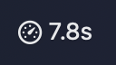

<h1 align="center">Claude Performance Analyzer</h1>

<p align="center">
  <strong>See where your Claude Code turns spend their time.</strong><br>
  Model latency, tools, hooks, skills, subagents and MCP startup, live in your macOS menu bar.
</p>

<p align="center">
  
  
  
  
  <a href="LICENSE"></a>
</p>

<p align="center">
  
  <br>
  <sub><a href="docs/screenshots/menubar-demo.mp4">Watch the demo in full quality (MP4)</a></sub>
</p>

---

## Why

A slow Claude Code turn can come from many places: the model, a long Bash call, a hook that runs on every prompt, an MCP server that takes seconds to connect. Claude Code already reports all of this through OpenTelemetry. Claude Performance Analyzer collects that data on your machine and turns it into answers:

- Is the model slow right now, or is it my setup?
- Which hook adds time to every prompt?
- Which tools, skills and subagents eat the most time?
- What did this session cost, and how well is the prompt cache working?

## Features

- **Glanceable menu bar label.** API p50 latency over the last 15 minutes. It turns into a warning triangle when hooks are slow.
- **Native SwiftUI panel.** Headline numbers, a latency chart, the API, tools and hooks split, and ranked lists, in 15m, 1h, 24h or 7d windows.
- **Drill-down detail cards.** Click any row to see its count, failures, p50, p95 and max, a split by repository, and recent calls.
- **Live feed.** Hook, tool and model events as they arrive, within a few seconds.
- **Web dashboard.** Turn waterfall, recent prompts, skills, subagents, models, permission decisions, MCP connect times, errors and compaction.
- **One-click setup.** The dashboard adds the needed telemetry variables to `~/.claude/settings.json`, keeps your existing values and writes a backup first.
- **MCP server for coding agents.** An agent can ask what its own harness costs: hook time, how much text hooks inject into context, and how much of that is Hindsight memory.
- **Remote hosts.** Other Linux or macOS machines on your tailnet can send their telemetry here, each with its own token. Pick a host in the panel or the dashboard to see its numbers.
- **Private by design.** With no remote hosts the collector listens on `127.0.0.1` only. Data stays in a local SQLite file for 14 days.

## Quick start

**Requirements:** macOS 14 or later.

Download the `.dmg` from the [latest release](https://github.com/kolezka/claude-performance-analyzer/releases/latest), drag ClaudeTelemetry to Applications and open it. The app ships the collector and starts it in the background as a login item, so it keeps recording while the app is closed. You can turn it off in Settings > General, or in System Settings > General > Login Items.

To build from source instead, you need [Bun](https://bun.sh) and Xcode 26:

```bash
git clone https://github.com/kolezka/claude-performance-analyzer.git
cd claude-performance-analyzer
bun install
bun run start      # collector and dashboard on http://127.0.0.1:4318
bun run app        # build and open the menu bar app
```

Then connect Claude Code. Open http://127.0.0.1:4318 and use the setup button, or add these to the `env` block of `~/.claude/settings.json` yourself:

```bash
CLAUDE_CODE_ENABLE_TELEMETRY=1
OTEL_LOGS_EXPORTER=otlp
OTEL_METRICS_EXPORTER=otlp
OTEL_EXPORTER_OTLP_PROTOCOL=http/json      # http/protobuf works too; grpc does not
OTEL_EXPORTER_OTLP_ENDPOINT=http://127.0.0.1:4318
OTEL_LOGS_EXPORT_INTERVAL=1000            # how "real time" the live feed is
OTEL_LOG_TOOL_DETAILS=1                 # real skill, MCP and subagent names
CLAUDE_CODE_ENHANCED_TELEMETRY_BETA=1   # optional: time to first token, turn spans
OTEL_TRACES_EXPORTER=otlp
```

Start a new Claude Code session. Only sessions started after this point are recorded.

The setup button always configures this Mac, whichever host you have selected.

## Remote hosts

Claude Code on another machine (Linux or macOS) can send its telemetry to the collector on this Mac over [Tailscale](https://tailscale.com). Nothing of ours runs on the other machine.

1. On this Mac, open the Hosts section in the dashboard or the Hosts tab in the app's Settings, and add a host with a name.
2. Copy the `env` block it shows. It holds the host's token and this Mac's Tailscale address, and it is shown only once. Regenerate the token if you lose it.
3. Paste the block into the `env` of `~/.claude/settings.json` on the other machine and start a new Claude Code session there.

The block looks like this:

```json
{
  "env": {
    "OTEL_EXPORTER_OTLP_ENDPOINT": "http://100.x.y.z:4318",
    "OTEL_EXPORTER_OTLP_HEADERS": "Authorization=Bearer cpa_...",
    "...": "the same telemetry variables as above"
  }
}
```

If this Mac has no Tailscale address when you add the host, the block says `<THIS_MAC_TAILSCALE_IP>`. Replace it with the address from `tailscale ip -4`.

What to expect:

- Adding the first host makes the collector listen on all addresses (`::`, IPv4 and IPv6). macOS may ask once whether to allow incoming connections. Removing the last host takes it back to `127.0.0.1` only. Neither needs a restart.
- Remote data is accepted only from Tailscale addresses (`100.64.0.0/10`, `fd7a:115c:a1e0::/48`) and only with a valid token. Anything else gets `401` or `403` and nothing is stored.
- The dashboard, the API, setup, host management and the live feed answer to this Mac only. A tailnet peer gets `403` on all of them, even with a faked `Host` header.
- Removing a host deletes its token and all of its saved telemetry. Regenerating a token stops the old one at once.
- This Mac cannot see the other machine's disk, so remote rows show the paths as they were sent, with no repo name, worktree or branch lookup. Remote hooks show what telemetry registered (event, matcher, source, plugin), not the command or config file.

## The menu bar app




The **label** shows API p50 latency over the last 15 minutes and refreshes every 2 seconds. Hooks count as slow when they take more than 15% of in-turn time, or when one hook has a p95 above 2s. Then the gauge changes to a warning triangle.

Click the label to open the **panel**:

| Section | What it shows |
| --- | --- |
| Header | Host picker (This Mac or a remote host), time window picker (15m, 1h, 24h, 7d) and collector status |
| Headline numbers | API p50 and p95, time to first token, turn duration, cost, cache hit rate, sessions |
| API latency | p50 and p95 over time |
| Where turn time goes | Split between API, tools and hooks |
| Slowest | Top items by p95, filtered by tools, hooks or agents |
| By total time | Top items by summed duration, with the same filters |
| Live | Latest hook, tool and model events |

The panel polls only while it is open.

**Settings** let you launch at login, pick the default window and the windows in the header, point at another collector URL, tune polling intervals, change the label style, set the panel width and hide any section. The **Hosts** tab adds, regenerates and removes remote hosts.

<br clear="right">

## How it works

```
                       this Mac
Claude Code ──OTLP, loopback──────────▶ collector :4318 ──▶ SQLite
                                         │  (127.0.0.1 only, or
remote machine (optional)                │   all addresses once a
Claude Code ──OTLP, Tailscale + token───▶│   remote host exists)
                                         │
                                         ├── /api/* over loopback ──▶ menu bar app
                                         └── web dashboard over loopback
```

Claude Code exports logs, metrics and traces over OTLP. The collector decodes them, stores them in `~/.claude-telemetry/telemetry.sqlite` and serves a small JSON API. The menu bar app and the dashboard both read from that API over loopback.

Without remote hosts, nothing leaves your machine. With them, each remote machine's telemetry crosses your tailnet to this Mac, authenticated by its token. Stored data and every API read stay on this Mac. Every stored row carries the host its token belongs to, and each read shows one host at a time.

## Ask from a coding agent (MCP)

`apps/mcp` is a stdio MCP server an agent can call to see what its harness costs, so it can trim or fix hooks, plugins and memory settings. It only reads: it never changes settings or hooks.

It ships as the `performance-analyzer` Claude Code plugin. You need [Bun](https://bun.sh) on your `PATH`. Hook time also needs the collector running; without it, the injected-text answers still work and hook time says it is unavailable.

```bash
claude plugin marketplace add kolezka/marketplace
claude plugin install performance-analyzer@kolezka
```

Start a new session afterwards. The tools show up as `mcp__plugin_performance-analyzer_harness__*`.

To run it from a checkout instead, with no plugin:

```bash
claude mcp add --scope user cpa-harness -- bun "$PWD/apps/mcp/src/index.ts"
```

To try the plugin build for one session: `bun run build:plugin`, then `claude --plugin-dir .`. Releases come from the `Release plugin` workflow, which builds `dist/` onto the `release` branch the marketplace installs from. Bump `version` in `.claude-plugin/plugin.json` first; the workflow refuses to republish the same version.

| Tool | Answers |
| --- | --- |
| `harness_summary` | Start here: hook time, injected text and the Hindsight share in one answer |
| `hook_time` | Per hook: firings, total, p50, p95, max, errors, share of active turn time, and per-command runs with the plugin or settings file that owns them |
| `injected_context` | What hooks put into the model's context, grouped by source, event, prompt, session or project, with owners and identical repeats |
| `memory_cost` | Hindsight injection by tag, per prompt, recalls too large for context and whether the agent read them back |
| `harness_query` | One read-only SQL query over the same data and the telemetry tables, run in a child process and stopped after 10 seconds |

Every tool takes `session`: `current` (default), `all`, or a session id. `since` (`15m`, `1h`, `24h`, `7d`) and `project` narrow it down. `current` is the session that started the server, from `CLAUDE_CODE_SESSION_ID`; each answer names the session it used.

Where the numbers come from:

- Hook time comes from the collector's telemetry. All hooks of one event run in parallel, so a firing's time is wall time, not per script. Per-command times come from the transcripts, which Claude Code writes only for some hooks. The share of active turn time is given for whole sessions only, since a `since` window cuts turns in half.
- Injected text comes from the session transcripts in `~/.claude/projects`, counted as the model received it, including the reminder wrapper Claude Code puts around it. Output too large for context counts as the preview Claude Code showed; it counts as read back only when the agent read the whole saved file and the read succeeded. Telemetry's own character count differs: it counts that output at full size and does not see every hook.
- Tokens are estimates: characters / 4.
- A block that no recorded hook run printed is reported as unattributed, with the hooks configured for that event. Hindsight blocks are recognised by their `<hindsight_*>` tags.
- Transcripts stay on the machine that ran the session, so the server covers sessions on this Mac, not remote hosts.

`bun apps/mcp/scripts/probe.ts harness_summary '{"session":"all","since":"7d"}'` runs one tool from the shell and prints how long it took.

## Project layout

Bun workspaces. Each package has its own `src/` and `test/`.

| Path | What it does |
| --- | --- |
| `apps/collector` | Bun OTLP receiver (http/json or http/protobuf, gzip ok) on `127.0.0.1:4318`, or on all addresses while remote hosts exist. Stores to SQLite with 14 day retention, partitioned by host. Serves the dashboard and the JSON API. `scripts/compile.ts` builds it into a standalone binary for the app bundle. |
| `apps/dashboard` | Svelte web dashboard, bundled by the collector through its HTML import. |
| `apps/mcp` | Read-only stdio MCP server for coding agents: hook time, hook-injected context and Hindsight memory cost, from telemetry and session transcripts. |
| `apps/menubar` | SwiftUI menu bar app (`MenuBarExtra`), built with `swiftc` into a universal (arm64 and x86_64) `.app`. Bundles the compiled collector and runs it as a LaunchAgent. Code in `Sources/`, plists and icon in `Resources/`, build and release in `scripts/`. |
| `packages/otlp` | Decodes OTLP http/json and http/protobuf into rows. |
| `packages/analytics` | Summaries, percentiles, turn timelines. Shared by the collector and the dashboard. |
| `packages/claude-settings` | Adds the telemetry variables to Claude Code's `settings.json`. |

## Development

```bash
bun run dev        # collector in development mode
bun test           # all packages
bun run typecheck
```

A `Makefile` wraps the same commands. Run `make` to list targets.

## Limits

- Only sessions started after telemetry is turned on are recorded. There is no backfill.
- Rules have no timing in telemetry. They only appear as `source: config` permission decisions.
- Hook timing is per hook event and matcher (`PreToolUse:Bash`), not per script. Per-script detail needs detailed beta tracing.
- "Where turn time goes" adds up component durations, so parallel tool calls overlap.

## License

[MIT](LICENSE) © 2026 Mariusz Rakus

`packages/otlp/proto/` holds the OTLP `.proto` definitions from [open-telemetry/opentelemetry-proto](https://github.com/open-telemetry/opentelemetry-proto) v1.11.1, Apache 2.0 (see `packages/otlp/proto/LICENSE`).
