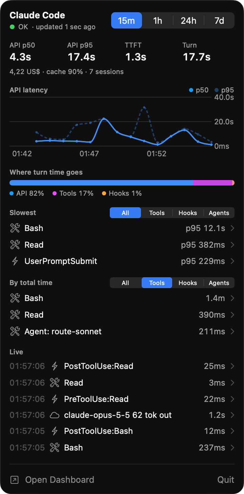

<h1 align="center">Claude Performance Analyzer</h1>

<p align="center">
  <strong>See why Claude Code feels slow.</strong><br>
  Model latency, tools, hooks, skills, subagents and MCP startup, live in your macOS menu bar.
</p>

<p align="center">
  <a href="https://github.com/kolezka/claude-performance-analyzer/releases/latest"></a>
</p>

<p align="center">
  
  
  
  <a href="LICENSE"></a>
</p>

<p align="center">
  
  <br>
  <sub><a href="docs/screenshots/menubar-demo.mp4">Watch the demo in full quality (MP4)</a></sub>
</p>

---

A slow Claude Code turn can come from many places: the model, a long Bash call, a hook that runs on every prompt, an MCP server that takes seconds to connect. Claude Code already reports all of this through OpenTelemetry. Claude Performance Analyzer collects it on your Mac and shows you where the time goes.

## What you get

- **Latency in your menu bar.** The model's response time over the last 15 minutes, always in view. It turns into a warning sign when hooks slow you down.
- **Where each turn spends its time.** Model, tools and hooks side by side, with the slowest items ranked.
- **Details on click.** Any tool, hook or subagent opens a card with p50, p95, failures, a split by repository and recent calls.
- **A full dashboard** in your browser: turn waterfall, recent prompts, skills, subagents, models, permission decisions, MCP connect times, errors and compaction.
- **An MCP server for your agent.** Claude can check what its own setup costs and help you trim it. [See below](#let-your-agent-check-its-setup-mcp).
- **Your other machines too.** Linux and macOS machines on your tailnet or your LAN can send their telemetry to this Mac.
- **Private.** Everything stays on your Mac, in a local database kept for 14 days.

## Get started

1. **Download** the `.dmg` from the [latest release](https://github.com/kolezka/claude-performance-analyzer/releases/latest). It is signed and notarized, and runs on Apple silicon and Intel Macs with macOS 14 or later.
2. **Install.** Open the `.dmg`, drag **ClaudeTelemetry** to Applications and open it. It appears in your menu bar.

   Or skip steps 1 and 2 with Homebrew, then open ClaudeTelemetry from Applications:

   ```bash
   brew install --cask kolezka/tap/claude-telemetry
   brew trust kolezka/tap   # lets a plain `brew upgrade` update it
   ```
3. **Connect Claude Code.** Click the menu bar item and choose **Open Dashboard** (or open http://127.0.0.1:4318), then click **Add … missing settings**. This adds the telemetry settings to `~/.claude/settings.json`. Your existing values are kept, and a backup is written first.
4. **Start a new Claude Code session.** Numbers show up within seconds. Sessions that were already running are not recorded.

The app keeps recording in the background, even while its panel is closed. You can turn that off in the app's Settings > General, or in System Settings > General > Login Items.

<details>
<summary>Prefer to edit the settings yourself?</summary>

Add these to the `env` block of `~/.claude/settings.json`:

```bash
CLAUDE_CODE_ENABLE_TELEMETRY=1
OTEL_LOGS_EXPORTER=otlp
OTEL_METRICS_EXPORTER=otlp
OTEL_EXPORTER_OTLP_PROTOCOL=http/json      # http/protobuf works too; grpc does not
OTEL_EXPORTER_OTLP_ENDPOINT=http://127.0.0.1:4318
OTEL_LOGS_EXPORT_INTERVAL=1000            # how "real time" the live feed is
OTEL_LOG_TOOL_DETAILS=1                 # real skill, MCP and subagent names
CLAUDE_CODE_ENHANCED_TELEMETRY_BETA=1   # optional: time to first token, turn spans
OTEL_TRACES_EXPORTER=otlp
```

</details>

## The menu bar app



The label shows the model's p50 latency over the last 15 minutes. It changes to a warning triangle when hooks take more than 15% of turn time, or when one hook's p95 is above 2 seconds.

Click it to open the panel: headline numbers, a latency chart, where turn time goes, the slowest items, the biggest total time and a live feed. Switch between 15 minutes, 1 hour, 24 hours and 7 days, or between this Mac and a remote host.

Everything in the panel can be tuned or hidden in Settings. More on each section: [docs/menu-bar-app.md](docs/menu-bar-app.md).

<br clear="right">

## Let your agent check its setup (MCP)

Hooks, plugins and memory tools add time and text to every prompt, and you rarely see how much. The `performance-analyzer` plugin gives Claude Code a read-only MCP server, so the agent can look at its own harness and tell you what to fix.

Ask it things like:

- "Which hooks slow down my prompts the most?"
- "How much text do my hooks add to every prompt, and which plugin adds it?"
- "How much of my context is Hindsight memory, and does it get used?"

Install it, then start a new session:

```bash
claude plugin marketplace add kolezka/marketplace
claude plugin install performance-analyzer@kolezka
```

It needs [Bun](https://bun.sh) on your `PATH`. Hook timing comes from the telemetry the app records, so install the app first. Without the app, the answers about injected text still work.

| Tool | What it answers |
| --- | --- |
| `harness_summary` | Start here: hook time, injected text and the Hindsight share in one answer |
| `hook_time` | Time per hook, with the plugin or settings file that owns it |
| `injected_context` | What hooks put into the model's context, and who put it there |
| `memory_cost` | How much Hindsight memory gets injected, and whether the agent reads it |
| `harness_query` | One read-only SQL query over the same data, for anything else |

The plugin also ships the `harness-cost` skill. It tells the agent when to reach for these tools, how to read the numbers and where each fix goes, so you can ask in plain words ("why is every prompt slow?").

The server only reads. It never changes your settings or hooks, and it covers sessions on this Mac. Parameters and where each number comes from: [docs/mcp.md](docs/mcp.md).

## Your other machines

Claude Code on another Linux or macOS machine can send its telemetry to this Mac over [Tailscale](https://tailscale.com) or your LAN. Nothing extra runs on the other machine.

1. In the app, open Settings > Hosts and add a host.
2. Pick which of this Mac's addresses it should send to (Tailscale or LAN), then copy the `env` block it shows. It is shown only once.
3. Paste it into `~/.claude/settings.json` on the other machine and start a new Claude Code session there.

Pick the host in the panel or the dashboard to see its numbers. Security and limits: [docs/remote-hosts.md](docs/remote-hosts.md).

## Privacy

- The collector listens on `127.0.0.1` only. It opens up only after you add a remote host, and then accepts telemetry only from Tailscale or private LAN addresses with a valid token. Over the LAN that traffic is not encrypted.
- Data lives in `~/.claude-telemetry/telemetry.sqlite` on your Mac and is deleted after 14 days.
- Without remote hosts, nothing leaves your Mac.

## Good to know

- Only sessions started after you connect Claude Code are recorded. There is no backfill.
- Telemetry times hooks per event and matcher (`PreToolUse:Bash`), not per script. Per-script detail needs detailed beta tracing. The MCP server adds per-command times where Claude Code logs them.
- Rules have no timing in telemetry. They only appear as `source: config` permission decisions.
- "Where turn time goes" adds up durations, so parallel tool calls overlap.

## Build from source

You need [Bun](https://bun.sh) and Xcode 26.

```bash
git clone https://github.com/kolezka/claude-performance-analyzer.git
cd claude-performance-analyzer
bun install
bun run start      # collector and dashboard on http://127.0.0.1:4318
bun run app        # build and open the menu bar app
```

How it fits together, the project layout and how releases work: [docs/development.md](docs/development.md).

## License

[MIT](LICENSE) © 2026 Mariusz Rakus

`packages/otlp/proto/` holds the OTLP `.proto` definitions from [open-telemetry/opentelemetry-proto](https://github.com/open-telemetry/opentelemetry-proto) v1.11.1, Apache 2.0 (see `packages/otlp/proto/LICENSE`).
