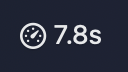
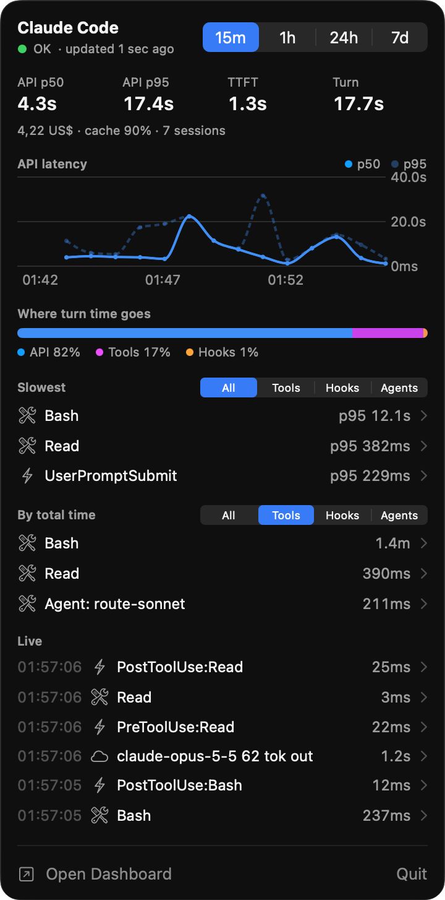

# The menu bar app

The **label** shows API p50 latency over the last 15 minutes and refreshes every 2 seconds. Hooks count as slow when they take more than 15% of in-turn time, or when one hook has a p95 above 2s. Then the gauge changes to a warning triangle.

Click the label to open the **panel**:

| Section | What it shows |
| --- | --- |
| Header | Host picker (This Mac or a remote host), time window picker (15m, 1h, 24h, 7d) and collector status |
| Headline numbers | API p50 and p95, time to first token, turn duration, cost, cache hit rate, sessions |
| API latency | p50 and p95 over time |
| Where turn time goes | Split between API, tools and hooks |
| Slowest | Top items by p95, filtered by tools, hooks or agents |
| By total time | Top items by summed duration, with the same filters |
| Live | Latest hook, tool and model events |

Click any row to open its detail card: count, failures, p50, p95 and max, a split by repository, and recent calls.

The panel updates live from the collector while it is open and refreshes every 30 s for values that change with time.

**Settings** let you launch at login, pick the default window and the windows in the header, point at another collector URL, set the request timeout and retry delay, change the label style, set the panel width and hide any section. The **Hosts** tab adds, regenerates and removes [remote hosts](remote-hosts.md).

 

## Background recording

The app ships the collector and starts it in the background as a login item, so it keeps recording while the app is closed. You can turn it off in Settings > General, or in System Settings > General > Login Items.
